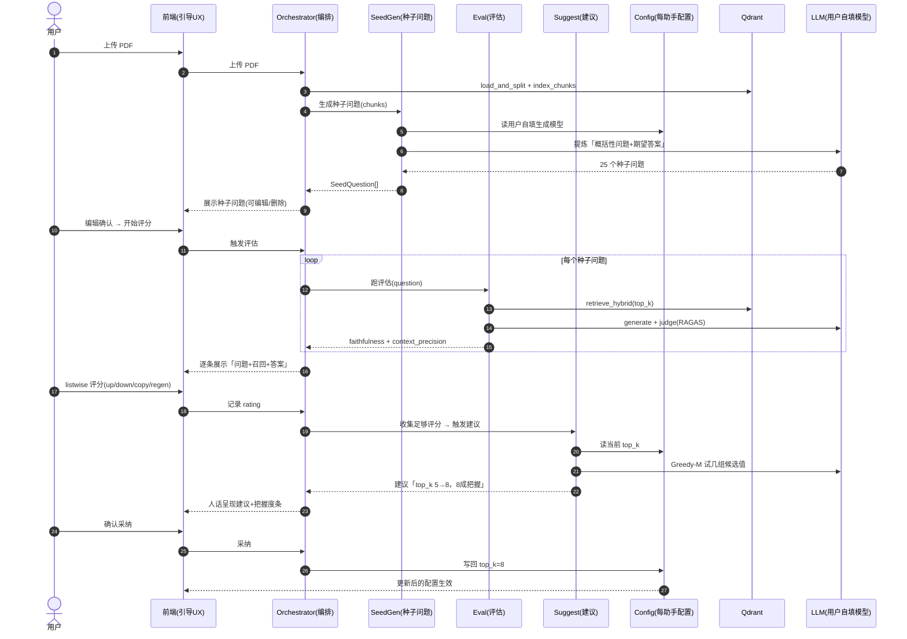

# MVP 技术拆解 — 评估闭环 + 引导 UX

- **状态**：草案 v0.1
- **日期**：2026-11-18
- **依赖**：`docs/product-design.md`（产品设计稿）
- **目标**：把「人本中心评估闭环」拆成可落地的模块/接口/数据流，明确挂载到现有 `enterprise-kb` demo 的哪个位置。

---

## 1. 现有基础（复用清单）

MVP 不是从零写，现有 demo 已有大量可复用件：

| 现有模块 | 文件 | 复用方式 |
|---|---|---|
| 配置（config-driven） | `config.py` | 参数已在 `RetrievalConfig`/`EmbeddingConfig`/`LLMConfig`/`RerankerConfig`，直接读 |
| 检索链路 | `retrieve.py` / `hybrid.py` / `rerank.py` | `retrieve_hybrid()`、`rerank()` 直接调用 |
| 生成 | `generate.py` | `generate_answer(query, contexts, model)` 直接调用 |
| 切分 | `ingest.py` | `load_and_split()` + `index_chunks()` |
| 评估 | `eval/eval_ragas.py` | RAGAS `faithfulness` + `context_precision` 打分逻辑可抽成库函数 |
| 会话存储 | `ui.db_path`（SQLite） | 扩表存评估结果 / golden case / 评分 |

**关键结论**：现有 `config.py` 是**全局单例**（`get_settings()`），而多租户/多助手场景需要**每助手一份配置**。这是 MVP 要做的**第一个架构改动**——从「全局 Settings」到「per-assistant config」。

---

## 2. 数据模型（新增）

新增几张表/结构（沿用现有 SQLite，或独立 `eval.db`）：

### 2.1 assistant（助手/租户）
```
assistant_id    UUID
name            str
template        str | None      # 模板名（devops / ui 等），自定义为 None
created_at      ts
```

### 2.2 assistant_config（每助手一份配置，替代全局 Settings）
```
assistant_id    UUID  (FK)
generative_model   str      # 强建议档位
embedding_model    str      # 强建议档位
top_k              int      # 用户自滑档位
chunk_size         int      # 用户自滑档位
rerank_enabled     bool     # 用户自滑档位
vector_store       str      # 用户自选（当前仅 "qdrant"）
chunk_overlap      int      # 不暴露（默认值）
temperature        float    # 不暴露（默认值）
```

### 2.3 golden_case（黄金案例）
```
case_id         UUID
assistant_id    UUID  (FK)
question        str
expected_answer str | None   # 可为空（仅存问题，人工后补答案）
source_docs     list[str]    # 期望召回的关键 chunk id / 文本片段
status          enum         # draft / active / retired
created_at      ts
updated_at      ts
```

### 2.4 evaluation_run（一次评估运行）
```
run_id          UUID
assistant_id    UUID  (FK)
config_snapshot json         # 跑这次评估用的配置快照（用于 diff）
seed_questions  int          # 种子问题数
created_at      ts
```

### 2.5 rating（用户评分，listwise）
```
rating_id       UUID
run_id          UUID  (FK)
question        str
rating          enum         # up / down / copied / regenerated
confidence      float        # 置信区间（ARES PPI 思路）
created_at      ts
```

---

## 3. 评估闭环：模块划分 + 数据流

```
┌─────────────────────────────────────────────────────────┐
│ ① 上传 PDF                                                │
│    ↓ ingest.load_and_split()  → chunks                    │
│    ↓ embed.index_chunks()    → Qdrant                     │
│                                                          │
│ ② 种子问题生成（新模块：seed_questions.py）                 │
│    ↓ 读 chunks → LLM 生成「概括性问题 + 期望答案」           │
│    ↓ 数量 20–30（IBM 采样结论：10% 就够）                   │
│                                                          │
│ ③ 跑一轮评估（新模块：evaluate.py）                        │
│    ↓ 每个种子问题 → retrieve_hybrid() + generate_answer()  │
│    ↓ RAGAS 打分（faithfulness / context_precision）        │
│    ↓ 产出 evaluation_run + config_snapshot                │
│                                                          │
│ ④ 用户 listwise 评分（新模块：rating.py）                   │
│    ↓ 用户对「整份结果」点赞/点踩/复制/重新生成               │
│    ↓ 存 rating + 计算置信区间                              │
│                                                          │
│ ⑤ 可解释建议（新模块：suggest.py）                         │
│    ↓ 读 ratings + config → Greedy-M 贪心                  │
│    ↓ 输出「建议调哪个参数 + 为什么」                         │
│    ↓ 用户确认 → 写回 assistant_config                      │
└─────────────────────────────────────────────────────────┘
```

---

## 4. 新增模块接口（伪签名）

### 4.1 `seed_questions.py` — 种子问题生成

> ✅ **已实现**（2026-11-18，`src/enterprise_kb/seed_questions.py`，13 测试全绿）

```python
def generate_seed_questions(
    chunks: list[dict],          # 修正自 list[str]：含 id/text/meta，需记 source_chunk_ids
    n: int = 25,                 # 种子问题数（20–30）
    model: str | None = None,    # 复用用户配置的生成模型
    batch_size: int = 5,         # 每批 chunk 数（减少 LLM 调用）
) -> list[SeedQuestion]:
    """从 chunks 生成概括性问题 + 期望答案。

    SeedQuestion = {question, expected_answer, source_chunk_ids}
    - 用 LLM 从 chunk 提炼「这条 chunk 能回答什么问题」
    - 期望答案直接从 chunk 原文抽取（真实召回答案）
    - source_chunk_ids 记录答案来自哪些 chunk（用于后续 golden case 的召回验证）
    """
```

**实现要点（spec delta）**：
- 采样：过滤 `< MIN_CHUNK_LEN=30` 的过短片段 → 按索引步长均匀采样（覆盖全文档而非局部）
- 批量生成：每批 `batch_size=5` 个 chunk 一次 LLM 调用，LLM 返回 `{"items": [{"index", "question", "answer"}]}`
- JSON 提取：`_extract_json` 容忍 ```json 包裹 / 前后杂质
- 容错：越界 index、非 dict item、`items` 非列表、解析失败 → 跳过该条/该批，不崩溃

### 4.2 `evaluate.py` — 跑一轮评估

> ✅ **已实现**（2026-11-18，`src/enterprise_kb/evaluate.py`，5 测试全绿）

```python
def run_evaluation(
    questions: list[SeedQuestion],  # 修正自 list[str]：需 expected_answer 作 reference
    config: ResolvedConfig | None = None,  # 修正自 dict：用 resolve 后的配置
    judge_model: str = "deepseek-chat",
) -> EvaluationRun:
    """每个问题：retrieve + generate + RAGAS 打分。
    复用现有 retrieve_hybrid / generate_answer / ragas 打分。
    产出每类问题的指标分数 + config_snapshot。
    """
```

**实现要点（spec delta）**：
- 去除 `assistant_id` 参数：MVP 不持久化（返回内存 `EvaluationRun`），存储交后续 `storage_eval.py`
- `config` 改为 `ResolvedConfig`（已 resolve 哨兵值），`config_snapshot = cfg.model_dump()` 供 diff
- `EvaluationResult` 含 `faithfulness` + `context_precision`（分开报，不合成总分）
- `EvaluationRun.avg_faithfulness` / `avg_context_precision` 属性求平均
- judge LLM 抽自 `eval_ragas.py` 的 `_build_judge_llm`（deepseek-chat）

### 4.3 `rating.py` — listwise 评分

> ✅ **已实现**（2026-11-18，`src/enterprise_kb/rating.py`，6 测试全绿）

```python
class Rating(BaseModel):
    question: str
    rating: Literal["up", "down", "copied", "regenerated"]

def positive_rate(ratings: list[Rating]) -> float:
    """正面评分占比（up + copied 视为正面）。"""

def compute_confidence(ratings: list[Rating]) -> float:
    """ARES PPI 思路：少量评分 → 置信区间，而非裸分。"""
```

**实现要点（spec delta）**：
- 去除 `record_rating`（持久化）→ 改为纯模型 + `positive_rate` + `compute_confidence`，持久化交后续 `storage_eval.py`
- `compute_confidence`：sigmoid 型 `1 - exp(-n/12)`，n=0→0，n=25→~0.88，永远不到 1（诚实）

### 4.4 `suggest.py` — 可解释建议（核心壁垒）

> ✅ **已实现**（2026-11-18，`src/enterprise_kb/suggest.py`，7 测试全绿）

```python
def suggest_top_k(
    current: int,
    scores: dict[int, float],       # {top_k: avg_faithfulness}
    ratings: list[Rating] | None = None,
) -> Suggestion | None:
    """对比不同 top_k 的评估分数，输出可解释建议。

    Suggestion = {param, current, recommended, reason, confidence, category}
    - 当前值已是候选最优 → None
    - 提升 < 5% 阈值 → None（避免噪音）
    - category: 连续参数（top_k/chunk_size）→ weak，说清权衡让用户滑
    """
```

**实现要点（spec delta）**：
- 原 `suggest_tuning(ratings, current_config)` → 改为纯函数 `suggest_top_k(current, scores, ratings)`：
  - **解耦**：不再内部跑评估（成本高、耦合），改为接收「评估分数 dict」作为输入，由调用方（编排层）跑评估后传入
  - 这样核心逻辑（对比 + 可解释 + 置信度）成为好测试的纯函数
- `_IMPROVEMENT_THRESHOLD = 0.05`：提升 < 5% 不建议，避免把评估噪音当「值得调」
- `confidence` 复用 `rating.compute_confidence`（样本量 → 置信度）
- **MVP 只做 top_k**（连续 → weak）；Greedy-M 的离散参数（模型/embedding）→ strong 建议，留待后续扩展

### 4.5 `orchestrator.py` — 编排层（时序图 Orchestrator 角色）

> ✅ **已实现**（2026-11-18，`src/enterprise_kb/orchestrator.py`，4 测试全绿）

```python
def suggest_top_k_workflow(
    assistant_id: str,
    questions: list[SeedQuestion],
    ratings: list[Rating] | None = None,
    candidates: tuple[int, ...] = (3, 5, 8, 10),
) -> Suggestion | None:
    """最小闭环的「建议」编排：跑多组 top_k 评估 → 收集 scores → suggest。"""

def apply_suggestion(assistant_id: str, suggestion: Suggestion) -> ResolvedConfig:
    """用户确认后写回 assistant_config（只覆盖建议涉及的参数）。"""
```

**实现要点（spec delta）**：
- orchestrator 只做「散件之外的增量」：跑多组评估 + 写回；其余步骤（上传/种子问题/单轮评估/评分）直接调现有模块，不重复封装（薄封装无增量价值）
- `suggest_top_k_workflow`：对每个候选 top_k 用 `model_copy(update={"top_k": k})` 跑评估 → 收集 `{top_k: avg_faithfulness}` → 调 `suggest_top_k`
- `apply_suggestion`：只写建议涉及的参数（MVP 固定 top_k），其余字段回退全局，符合「人确认才写回」哲学

### 4.6 `storage_eval.py` — 评估数据持久化

> ✅ **已实现**（2026-11-18，`src/enterprise_kb/storage_eval.py`，9 测试全绿）

```python
def save_evaluation_run(assistant_id, config_snapshot, seed_questions, run_id=None) -> str
def save_rating(run_id, question, rating, rating_id=None) -> str
def get_evaluation_run(run_id) -> EvaluationRunRecord | None
def get_ratings(run_id) -> list[RatingRecord]
def get_latest_run(assistant_id) -> EvaluationRunRecord | None
def delete_evaluation_run(run_id) -> bool
```

**实现要点（spec delta）**：
- 独立 `eval.db`（不污染会话库 `ui.db`，也不混入 `assistant.db` 的配置）
- `assistant_id` 是**逻辑关联**（跨 db 无外键）；`ratings.run_id` 是同 db 内 FK `ON DELETE CASCADE`
- `config_snapshot` 用 json（dict 完整往返，含 `0.0` 边界值），供后续 diff
- **rating 表不存 `confidence`**（§2.5 的字段）：它是 `compute_confidence` 针对一批运行时算的，不落库；单条 rating 只存 question + rating + created_at
- golden_case 表后置（MVP 不做 golden case 回归）

---

## 5. 建议引擎实现要点

**遵循 `product-design.md` §5 的结论：简单贪心，不用 MAB。**

1. **Greedy-M 顺序**：先生成模型 → embedding → chunk size → top_k
2. **可解释性优先级**：
   - 离散参数（`generative_model` / `embedding_model`）：直接对比「改 vs 不改」的评分差异，给出数字理由
   - 连续参数（`top_k` / `chunk_size`）：试几组候选值，报告趋势 + 权衡，不强推单点
3. **置信度来源**：样本数（评分条数）→ 样本少时降级为「弱建议」或「暂不推荐，再多评几条」
4. **诚实性**：复用 `product-design.md` §4.2 红线——不硬编码最优参数表，一切基于该用户真实数据

---

## 6. 引导 UX（前端新增）

沿用现有 React + Vite 前端（`web/`），新增两个界面：

### 6.1 冷启动引导（onboarding）
```
上传 PDF → 进度条（解析/切分/索引/生成种子问题）
  → 展示种子问题列表（可编辑/删除，用户自由改）
  → 「开始评分」→ 逐条展示「问题 + 召回答案 + 生成答案」
  → 用户点 up/down/copy/regenerate
  → 评分置信度可视化（如「已评 12/25，置信度 中」）
  → 产出建议
```

**实现状态（2026-11-18）**：
- 后端端点：`eval_api.py`（`POST /api/eval/{upload,seed-questions,evaluate,suggest,apply}`），已 `include_router` 到 `api.py`
- 前端组件：`OnboardingWizard.tsx`（5 步向导：上传→种子问题→评分→建议→完成），入口按钮在 `App.tsx` header
- API 客户端：`client.ts` 新增 `uploadDocument/seedQuestions/runEvaluation/suggest/applySuggestion` + 类型（`SeedQuestion/EvaluationResult/Rating/Suggestion`）
- 置信度：前端复现 `1 - e^(-n/12)`（进度条 + 百分比）
- i18n：`i18n.ts` 新增 `eval*` 文案（zh/en）
- 测试：`test_eval_api.py`（9 用例）+ `OnboardingWizard.test.tsx`（8 用例）

### 6.2 版本 diff 可视化（golden case 回归）
```
发新版 → 用旧 golden case 在新版上回归
  → diff 视图：每条 golden case 的「召回块是否丢失/改变」高亮
  → 提示「内容变了」→ 引导用户更新 golden case
```

**关键设计**：diff 是「引导式」，不是工程师 CI 报表——告诉用户「这条变差了，因为这段文档改了，要不要更新」。

---

## 7. 落点映射（改哪些现有文件）

| 改动 | 文件 | 类型 |
|---|---|---|
| 全局 Settings → per-assistant config | `config.py` + 新增 `assistant.py` | 架构改动（第一步） |
| 扩表存评估/golden/评分 | 新增 `storage_eval.py`（evaluation_run + rating 已实现，golden_case 后置） | 新增 |
| 种子问题生成 | 新增 `seed_questions.py` | 新增 |
| 跑评估（复用 ragas） | 抽 `eval/eval_ragas.py` 打分逻辑 → `evaluate.py` | 重构 |
| listwise 评分 + 置信度 | 新增 `rating.py` | 新增 |
| 可解释建议 | 新增 `suggest.py` | 新增（核心） |
| 编排层（跑多组评估 + 写回） | 新增 `orchestrator.py` | 新增 |
| 评估 REST 端点 | 新增 `eval_api.py`（`/api/eval/*`），挂载到 `api.py` | 新增 |
| 引导 UX | `web/` 前端新增 onboarding + diff 界面 | 前端新增 |

---

## 8. 最小可行验证（第一个里程碑）

**目标**：验证「非工程师愿不愿意用引导式评估」这个最关键假设。

最小闭环（不做多租户、不做模板）：
1. 单助手：上传 PDF → 自动生成种子问题 → 用户评分 → 收建议 → 确认
2. 建议引擎只做**一个参数**（先做 `top_k`，最直观、用户能感知）
3. 不做 golden case 版本回归（后置）

**验证指标**：
- 用户从「上传」到「收到建议」的完成率
- 用户对「建议理由」的理解度（能否复述为什么调）
- 采纳建议后，用户感知的质量变化

---

## 10. 最小闭环时序图



### 关键设计点（对应上图）

1. **种子问题生成用用户自填模型**（步骤 6–8）：`SeedGen` 读 `Config` 里的生成模型，不内置 judge
2. **评估分维度归因**（步骤 12–15）：每个问题产出 `faithfulness` + `context_precision` 两个独立分数，不合成总分
3. **评分是 listwise 低摩擦**（步骤 17–18）：up/down/copy/regenerate，不逐 chunk 打详细评语
4. **建议用 Greedy-M 只调 top_k**（步骤 19–22）：最小闭环只做一个参数，最直观、用户能感知
5. **把握度人话呈现**（步骤 21–22）：`Suggest` 内部算 PPI 置信区间，展示时翻译成「8 成把握」+ 可视化条
6. **人确认才写回**（步骤 23–26）：建议只是建议，用户点「确认采纳」才改 `Config`，符合「可解释建议 + 人确认」哲学
